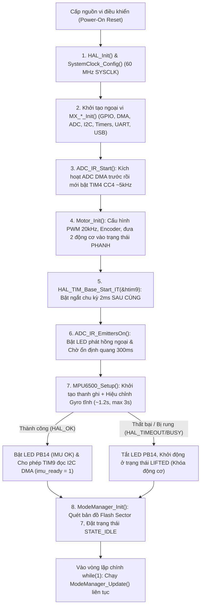
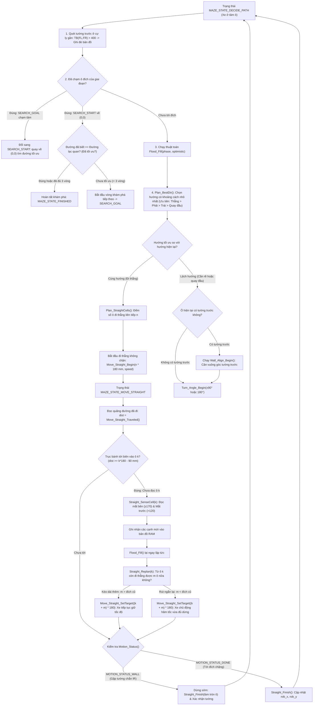
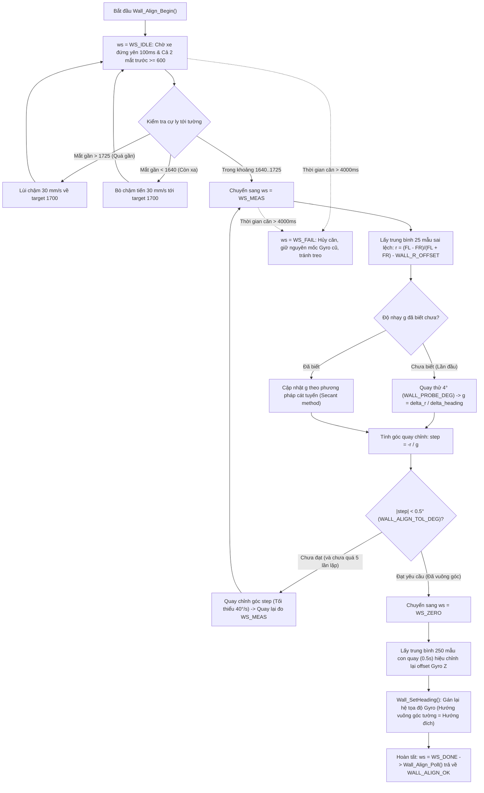
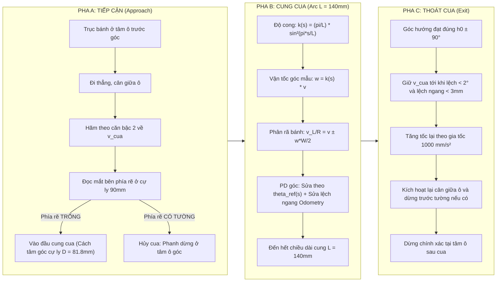
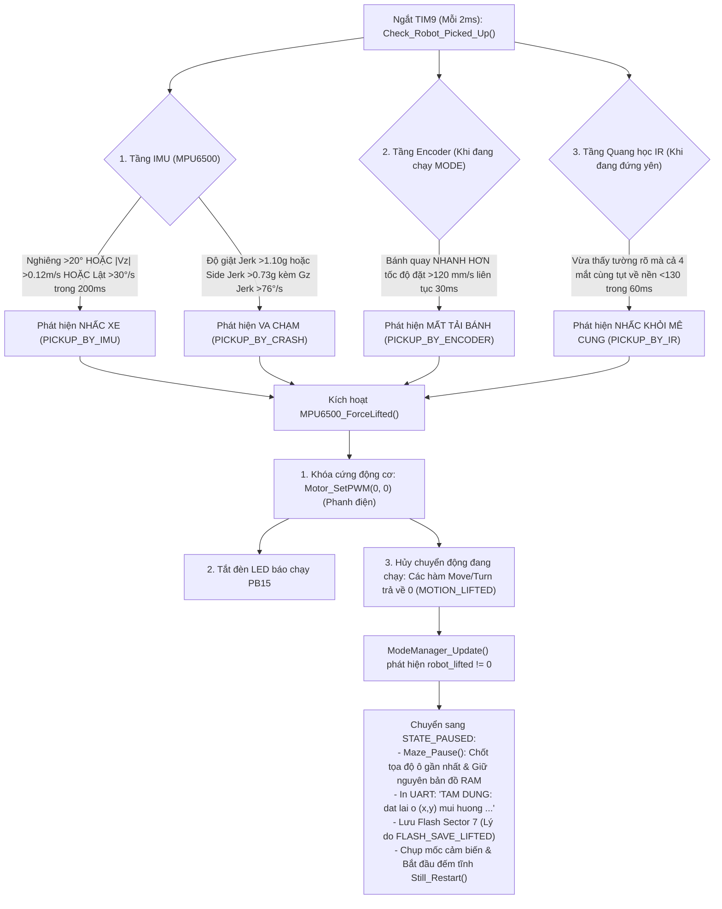
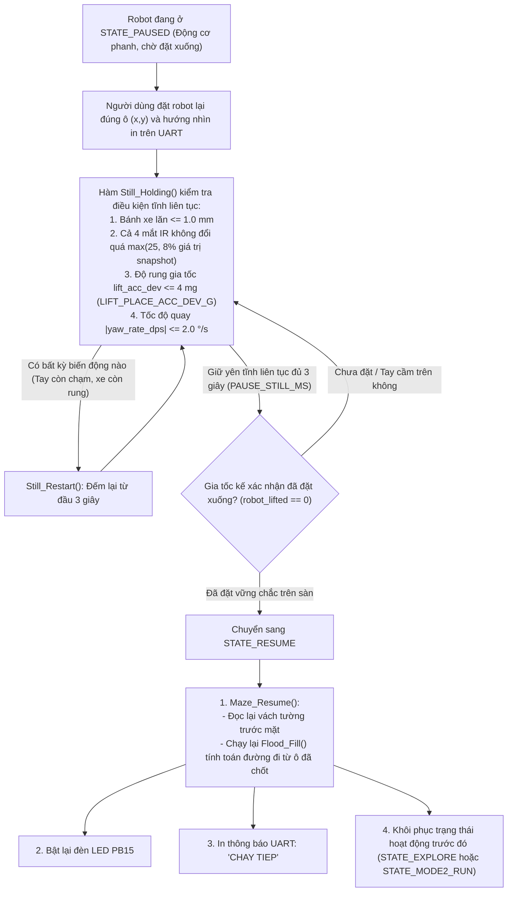

# QUY TRÌNH NGHIỆP VỤ & MÁY TRẠNG THÁI (BUSINESS FLOWS & STATE MACHINES)

Tài liệu này đặc tả chi tiết các quy trình nghiệp vụ cốt lõi, trình tự khởi động an toàn, các máy trạng thái điều khiển thời gian thực và các cơ chế xử lý ngoại lệ trong firmware Robot Micromouse.

---

## 1. Trình tự khởi động an toàn của hệ thống (Safe Boot Sequence)

Để đảm bảo các bộ điều khiển phản hồi không bị lỗi tín hiệu ngõ vào khi các cảm biến chưa sẵn sàng, firmware tuân thủ một trình tự khởi tạo nghiêm ngặt trước khi cho phép bánh xe chuyển động:



> [!IMPORTANT]
> **Quy tắc bất biến về thứ tự khởi động:**
> 1. `ADC_IR_Start()` phải bật DMA trước khi bật Timer Trigger `TIM4`. Nếu bật Timer trước, xung kích có thể rơi vào lúc ADC đã bật nhưng DMA chưa kịp kích hoạt, dẫn đến cờ tràn `OVR` bị set, khóa vĩnh viễn luồng DMA của ADC.
> 2. `HAL_TIM_Base_Start_IT(&htim9)` phải được gọi sau khi PWM và Encoder đã khởi tạo xong, nhưng trước `MPU6500_Setup()`. Trong quá trình hiệu chỉnh tĩnh, ngắt TIM9 vẫn chạy nhưng cờ `imu_ready` vẫn bằng 0 nên chưa phát sinh đọc DMA I2C, tránh xung đột trên bus I2C.

---

## 2. Máy trạng thái Quản lý Chế độ (Mode Manager State Machine)

Module `mode_manager.c` điều phối toàn bộ hành vi mức cao của robot thông qua enum `RobotState`. Toàn bộ máy trạng thái hoạt động dựa trên việc lưu mốc thời gian `HAL_GetTick()` và so sánh thời lượng, tuyệt đối không sử dụng hàm chờ `HAL_Delay()`.

```mermaid
stateDiagram-v2
    [*] --> STATE_IDLE

    state STATE_IDLE {
        description: "Động cơ phanh, chờ che mắt IR trái, phục vụ yêu cầu bản đồ UART"
    }

    state STATE_UI_BEEP {
        description: "Còi phát 1 tiếng bíp (250ms) xác nhận lần che vừa nhận"
    }

    state STATE_UI_WINDOW {
        description: "Đếm cửa sổ chờ 3 giây xem người dùng có che tiếp không"
    }

    state STATE_START {
        description: "Chờ 0.5s bỏ tay + xe nằm trên sàn + đo lại offset Gyro Z (0.5s)"
    }

    state STATE_EXPLORE {
        description: "Khám phá mê cung: Chạy Mode 1 hoặc Mode 3"
    }

    state STATE_MODE2_RUN {
        description: "Bứt tốc chạy nhanh tới tâm theo bản đồ tối ưu"
    }

    state STATE_GOAL_BEEP {
        description: "Còi reo 2 nhịp mừng chạm đích"
    }

    state STATE_RETURN_HOME {
        description: "Quay đầu 180° và chạy đường ngắn nhất về ô (0,0)"
    }

    state STATE_PAUSED {
        description: "Tạm dừng khẩn cấp do bị nhấc / va chạm, lưu Flash, chờ đặt lại"
    }

    state STATE_RESUME {
        description: "Đọc lại tường trước, tính lại đường từ ô chốt và tiếp tục"
    }

    state STATE_ERROR {
        description: "Phát còi lỗi 'tít tít tít' (3 nhịp dồn dập) rồi về IDLE"
    }

    %% Transitions
    STATE_IDLE --> STATE_UI_BEEP: Che mắt IR trái lần 1 (ui_count = 1)
    
    STATE_UI_BEEP --> STATE_UI_BEEP: Che tiếp trong lúc còi đang kêu (ui_count++)
    STATE_UI_BEEP --> STATE_UI_WINDOW: Còi vừa tắt
    
    STATE_UI_WINDOW --> STATE_UI_BEEP: Che thêm trong cửa sổ 3s (ui_count++)
    STATE_UI_WINDOW --> STATE_START: Hết 3s & ui_count hợp lệ (1, 2, 3)
    STATE_UI_WINDOW --> STATE_ERROR: Hết 3s & ui_count không hợp lệ (>= 4 hoặc lỗi Flash)

    STATE_START --> STATE_EXPLORE: Start_Mode1() hoặc Start_Mode3()
    STATE_START --> STATE_MODE2_RUN: Start_Mode2()

    STATE_EXPLORE --> STATE_EXPLORE: Chạm đích (Checkpoint -> Lưu Flash -> Đi tiếp)
    STATE_EXPLORE --> STATE_IDLE: Dò xong, về tới (0,0) quay Bắc -> Lưu Flash & Gửi map
    STATE_EXPLORE --> STATE_PAUSED: Bị nhấc xe hoặc Maze báo PAUSED
    STATE_EXPLORE --> STATE_ERROR: Kẹt xe, mất đường, lệch hướng > 30°

    STATE_MODE2_RUN --> STATE_GOAL_BEEP: Tới đích tâm (4 ô trung tâm)
    STATE_MODE2_RUN --> STATE_PAUSED: Bị nhấc xe / va chạm
    STATE_MODE2_RUN --> STATE_ERROR: Lỗi chuyển động

    STATE_GOAL_BEEP --> STATE_RETURN_HOME: Hết còi -> Maze_StartReturn()
    
    STATE_RETURN_HOME --> STATE_IDLE: Về tới ô (0,0) quay Bắc -> Gửi map
    STATE_RETURN_HOME --> STATE_PAUSED: Bị nhấc xe / va chạm

    STATE_PAUSED --> STATE_RESUME: Đặt xuống sàn, đứng im liên tục 3s (PAUSE_STILL_MS)
    STATE_RESUME --> STATE_EXPLORE: Khôi phục về Explore nếu trước đó đang dò
    STATE_RESUME --> STATE_MODE2_RUN: Khôi phục về Mode 2 Run
    STATE_RESUME --> STATE_RETURN_HOME: Khôi phục về Return Home

    STATE_ERROR --> STATE_IDLE: Hết còi lỗi
```

---

### 2.1 Giao diện "Nút bấm ảo" & Quy tắc chọn Chế độ

Robot không sử dụng nút nhấn cơ học để tránh rung lắc cơ khí và hỏng hóc tiếp điểm:
- **Nguyên lý nút ảo:** Mắt thu hồng ngoại phía trước bên trái (`adc_value[1]`) đóng vai trò cảm biến tiệm cận.
- **Tiêu chuẩn nhận diện một lần che (`UI_Pressed`):**
  - Mức thô $IRL > \text{UI\_IR\_PRESS\_RAW} = 2000$ liên tục trong thời gian $\ge \text{UI\_DEBOUNCE\_MS} = 30\text{ ms}$.
  - Người dùng bắt buộc phải rút tay ra ($IRL < \text{UI\_IR\_RELEASE\_RAW} = 1500$) thì hệ thống mới tái kích hoạt nhận diện lần che kế tiếp (`ui_armed = true`). Cố tình giữ tay lâu không bị tính thành nhiều lần nhấn.
- **Phản hồi âm thanh còi Buzzer:**
  - Mỗi lần che hợp lệ: còi kêu 1 tiếng dài $250\text{ ms}$ (`BUZZ_ON_MS`). Nếu người dùng che nhanh liên tiếp, các nhịp còi sẽ được đưa vào hàng đợi `ui_beeps_due` và phát cách nhau tối thiểu $300\text{ ms}$ (`UI_BEEP_GAP_MS`) để người dùng đếm rõ ràng.
- **Cửa sổ chốt chế độ (`UI_WINDOW_MS = 3000 ms`):**
  - Sau khi tiếng còi cuối cùng kết thúc, hệ thống đếm lùi 3 giây. Nếu không có thêm lần che nào, hệ thống chốt số lần che $N = \text{ui\_count}$ và tiến hành **kiểm tra an toàn tĩnh (Safety Check)** trước khi cho phép chạy:

| Số lần che | Chế độ gán | Điều kiện an toàn bắt buộc | Hành vi khi đạt chuẩn | Hành vi khi vi phạm |
| :---: | :---: | :--- | :--- | :--- |
| **1 lần** | **MODE 1** (Dò tiếp bản đồ cũ) | Flash Sector 7 phải có bản đồ hợp lệ (`Flash_LoadMap == FLASH_OK`) và cấu trúc biên mê cung đúng chuẩn (`Maze_ImportMap == true`). | Nạp bản đồ Flash vào RAM, xuất phát từ (0,0) hoặc tọa độ đã lưu, flood-fill dò tiếp các ô chưa biết. | Còi báo lỗi 3 tiếng ("tít tít tít"), in UART: *"Flash trong, chua co map"*, không chạy, về `STATE_IDLE`. |
| **2 lần** | **MODE 2** (Chạy nhanh + Về) | Đạt điều kiện Mode 1 **VÀ** bản đồ phải có đường đi từ xuất phát đến đích chỉ qua các cạnh đã biết (`FLASH_MAP_HAS_PATH` hoặc `Maze_HasPath() == true`). | Bứt tốc chạy thẳng đến đích với tốc độ cao $500\text{ mm/s}$, reo còi, quay 180°, chạy về ô xuất phát. | Còi báo lỗi 3 tiếng, in UART: *"map do, chua co duong toi dich"*, không chạy, về `STATE_IDLE`. |
| **3 lần** | **MODE 3** (Dò mê cung mới) | Luôn luôn hợp lệ. | Phát 1 tiếng bíp dài $1000\text{ ms}$ (`CONFIRM_LONG_BEEP_MS`), xóa trắng bản đồ RAM, ghi đè 1 bản ghi mới vào Flash rồi bắt đầu dò. | Không bao giờ bị từ chối. |
| **$\ge 4$ lần** | Không hợp lệ | Không thỏa mãn điều kiện giao diện. | Ngăn ngừa việc che lố tay vô tình xóa mất bản đồ. | Còi báo lỗi 3 tiếng, in UART: *"che qua 3 lan"*, về `STATE_IDLE`. |

---

## 3. Quy trình Thuật toán Giải mê cung Chạy liên tục (Continuous Motion Flood-Fill)

Điểm đột phá của hệ thống là khả năng **di chuyển liên tục, gộp nhiều ô thẳng thành một chặng duy nhất, vừa chạy vừa quét cảm biến và điều chỉnh đích đến ngay trong khi đang chuyển động**:



---

## 4. Quy trình Tự căn Vuông góc Tường trước (`Wall_Align`)

Chạy hoàn toàn trong ngắt thời gian thực ở chế độ `MOTION_HOLD`. Giúp triệt tiêu sai số tích lũy của con quay Gyro và định tâm lại robot trong ô:



---

## 5. Quy trình Cua mượt 90 độ (Smooth 90° Curve Turn)

Thay vì dừng lại ở tâm ô rồi quay tại chỗ, robot có thể thực hiện khúc cua mượt 90 độ liên tục mà không làm gián đoạn gia tốc bánh:



---

## 6. Quy trình Giám sát Sự cố & Bảo vệ An toàn (Safety System)

Hệ thống triển khai 4 tầng bảo vệ giám sát liên tục trong ngắt cứng TIM9 (chu kỳ 2 ms):



---

## 7. Quy trình Tạm dừng & Khôi phục Chuyển động (Pause & Resume Flow)

Khi robot bị nhấc lên khỏi sàn hoặc va chạm vào tường, người dùng có thể nhấc robot lên, đặt lại vào đúng tâm ô và hướng nhìn được in ra trên cổng UART; robot sẽ tự động tiếp tục phần hành trình dở dang mà không cần cấu hình lại:


