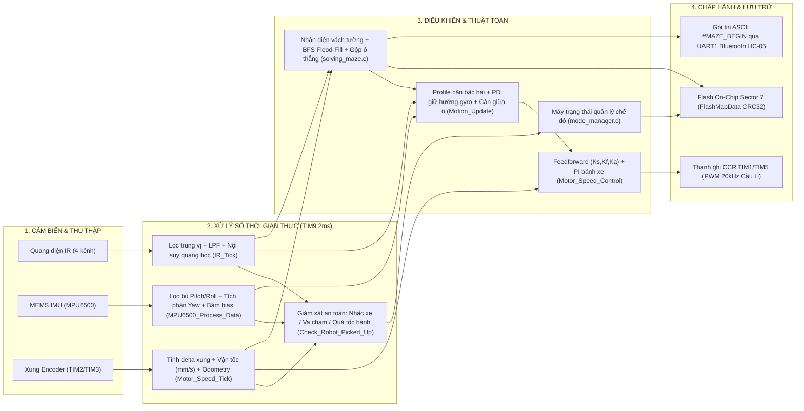
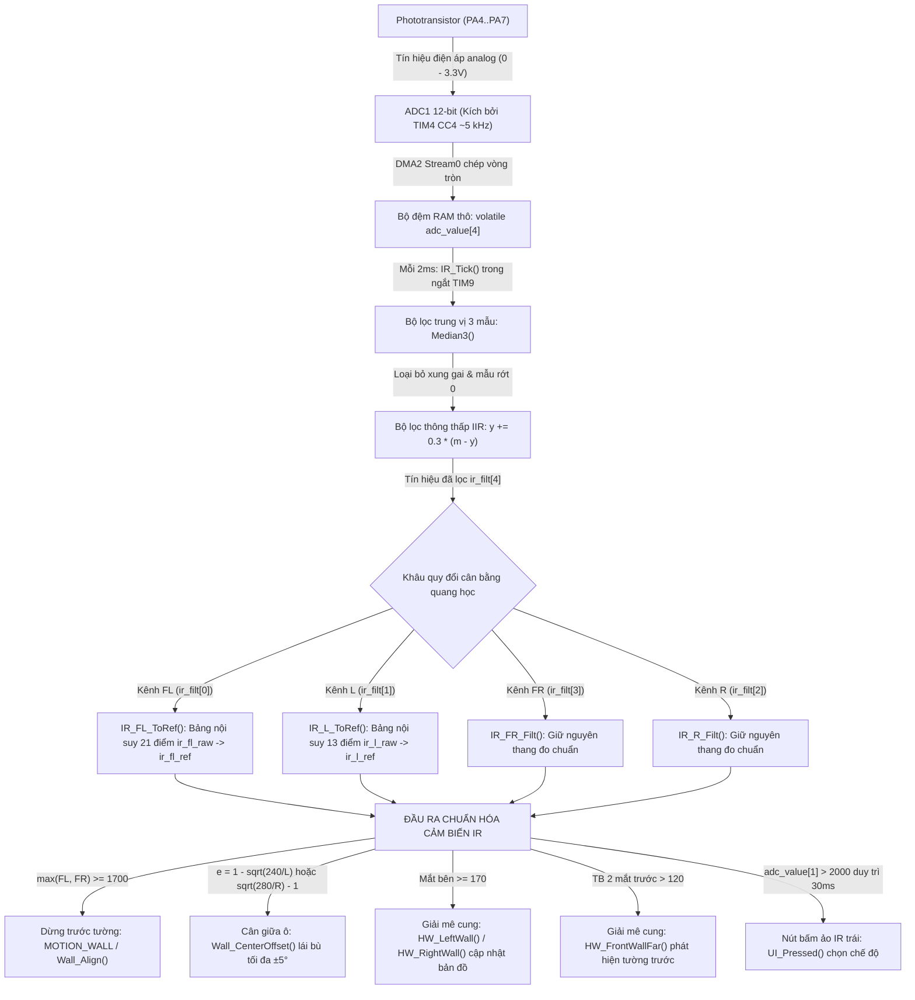
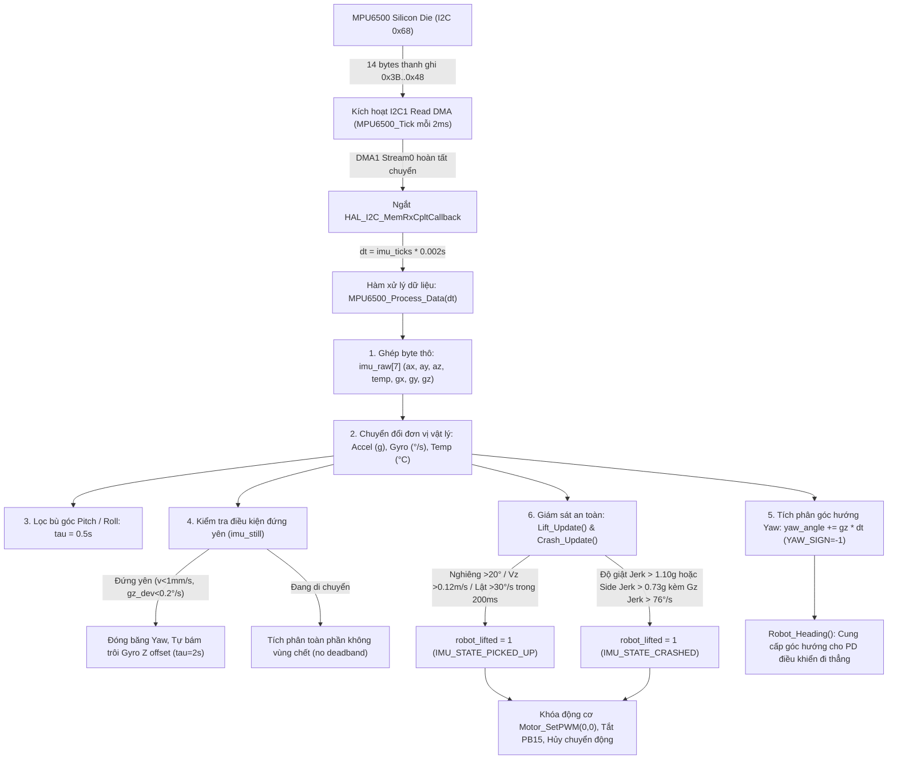
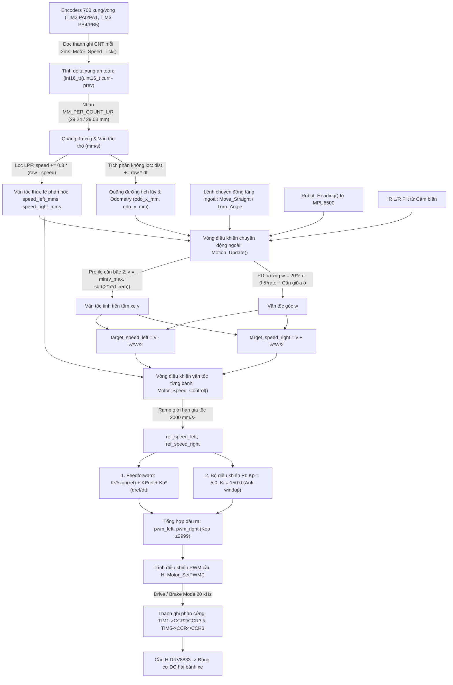
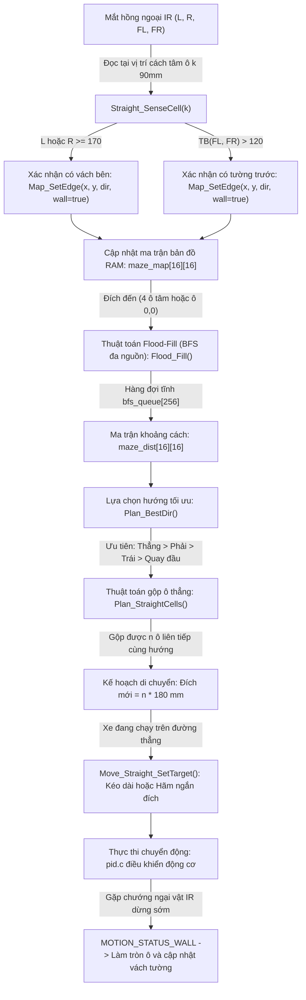
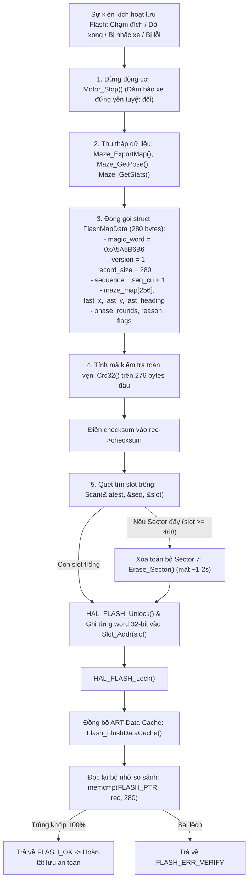
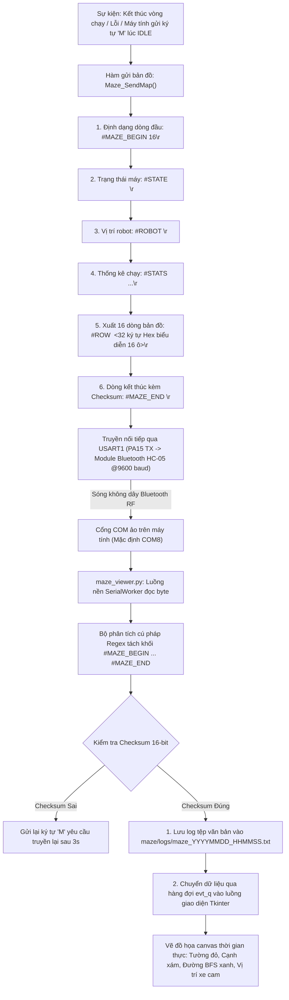

# ĐẶC TẢ CHI TIẾT CÁC LUỒNG DỮ LIỆU (DATA FLOW SPECIFICATION)

Tài liệu này truy vết toàn diện và chi tiết đường đi của dữ liệu xuyên suốt hệ thống: từ tín hiệu phần cứng ngõ vào, qua các khâu xử lý/lọc số, biến đổi toán học trung gian, đến tác động điều khiển phần cứng ngõ ra hoặc lưu trữ lâu dài.

---

## 1. Tổng quan các luồng dữ liệu chính

Hệ thống bao gồm 6 luồng dữ liệu cốt lõi hoạt động song song và trao đổi dữ liệu với nhau qua bộ nhớ RAM dùng chung:



---

## 2. Truy vết chi tiết từng luồng dữ liệu

---

### Luồng 1: Dữ liệu Cảm biến Hồng ngoại (IR Optical Wall Sensing & Filtering)

Luồng dữ liệu này chịu trách nhiệm chuyển đổi điện áp tương tự từ 4 bộ thu hồng ngoại thành thông tin nhận biết sự hiện diện của tường, đo độ lệch tâm trong hành lang ô và phục vụ thuật toán tự căn vuông góc.



#### Chi tiết các bước chuyển hóa dữ liệu:
1. **Nguồn dữ liệu:** Bộ thu hồng ngoại quang điện (Phototransistors) trên các chân PA4 (FL), PA5 (L), PA6 (R), PA7 (FR).
2. **Khâu thu thập (Hardware sampling):**
   - Bộ định thời `TIM4` phát xung kích hoạt (trigger) tần số ~5 kHz tại kênh CC4.
   - Bộ chuyển đổi tương tự - số `ADC1` lấy mẫu tuần tự 4 kênh với độ phân giải 12-bit (giá trị số $0 \dots 4095$).
   - Bộ điều khiển truy cập bộ nhớ trực tiếp `DMA2_Stream0` tự động truyền kết quả vào mảng nhớ `volatile uint16_t adc_value[4]` trong RAM mà không tiêu tốn chu kỳ CPU.
3. **Khâu lọc nhiễu số (Digital Signal Filtering - `IR_Tick`):**
   - Được gọi mỗi 2 ms từ ngắt `TIM9`.
   - **Lọc trung vị 3 mẫu (`Median3`):** Duy trì cửa sổ trượt 3 mẫu gần nhất `ir_hist[c][3]`. Lấy giá trị nằm giữa giúp loại bỏ hoàn toàn các xung nhiễu nhọn từ tia lửa điện hoặc mẫu bị tụt áp tức thời.
   - **Lọc thông thấp IIR bậc 1:** 
     $$y_k = y_{k-1} + K \cdot (m_k - y_{k-1}) \quad (\text{với } K = \text{IR\_FILT\_K} = 0.3)$$
     Hằng số thời gian trễ tương đương ~6-8 ms, giúp triệt tiêu nhiễu dao động cao tần (noise reduction ~65%).
4. **Khâu chuẩn hóa và cân bằng quang học (Optical Equalization):**
   - Do sai số chế tạo linh kiện, kênh FL nhạy hơn FR gấp 2.4 - 2.8 lần và bị nén/bão hòa sớm tại `IR_FL_SAT = 3800`.
   - Kênh FR được chọn làm thang đo chuẩn tham chiếu cho phía trước; Kênh R làm thang đo chuẩn tham chiếu cho vách bên.
   - `IR_FL_ToRef(raw)` tra bảng 21 nút và nội suy tuyến tính từng đoạn (`IR_Interp`) để ánh xạ tín hiệu FL về tương đương với FR ở cùng cự ly phản xạ.
   - `IR_L_ToRef(raw)` tra bảng 13 nút ánh xạ tín hiệu L về tương đương với R.
5. **Đích nhận và sử dụng dữ liệu:**
   - **Điều khiển chuyển động (`pid.c`):** Đọc qua các getter `IR_FL_Filt()`, `IR_FR_Filt()`, `IR_L_Filt()`, `IR_R_Filt()`. Phục vụ dừng khẩn cấp trước tường (`WALL_TARGET_IR = 1700`), tránh tường bên (`WALL_SIDE_IR = 1200`) và cân giữa ô (`WALL_CENTER_L_IR = 240, WALL_CENTER_R_IR = 280`).
   - **Thuật toán mê cung (`solving_maze.c`):** Đọc qua `HW_LeftWall()`, `HW_RightWall()`, `HW_FrontWallFar()`, `HW_FrontWallNear()` để ghi nhận vách tường vào ma trận `maze_map[][]`.
   - **Giao diện người dùng (`mode_manager.c`):** Đọc trực tiếp giá trị thô `adc_value[1]` để làm nút bấm ảo che tay.

---

### Luồng 2: Dữ liệu Cảm biến Quán tính IMU (MPU6500 Gyro & Accel Processing)

Luồng dữ liệu này đo đạc gia tốc 3 trục và tốc độ góc 3 trục, tính toán góc tư thế (Pitch/Roll) và góc quay hướng (Yaw), phục vụ vòng điều khiển ổn định hướng và các thuật toán an toàn.



#### Chi tiết các bước chuyển hóa dữ liệu:
1. **Nguồn dữ liệu:** Cảm biến MPU6500 trên bus I2C1 (tần số 300 kHz).
2. **Kích hoạt đọc bất đồng bộ:**
   - Trong ngắt `TIM9` mỗi 2 ms, hàm `MPU6500_Tick()` gọi `HAL_I2C_Mem_Read_DMA(&hi2c1, MPU6500_ADDR, 0x3B, ..., 14)`.
   - Vi điều khiển không bị chiếm dụng CPU trong quá trình nhận 14 byte qua I2C.
3. **Tiếp nhận ngắt DMA (`HAL_I2C_MemRxCpltCallback`):**
   - Đo thời gian thực tế `dt = imu_ticks * CONTROL_DT` (phòng ngừa trường hợp bus bận bỏ lỡ tick).
   - Chuyển tiếp vào `MPU6500_Process_Data(dt)`.
4. **Biến đổi vật lý:**
   - Ghép byte Big-Endian: $\text{raw} = (\text{MSB} \ll 8) \mid \text{LSB}$.
   - Gia tốc: $a_x, a_y, a_z = \text{raw} / \text{ACCEL\_LSB\_PER\_G}$ (với dải $\pm 8\text{ g}$, hệ số chia là $4096.0$).
   - Vận tốc góc: $g_x, g_y, g_z = (\text{raw} - \text{offset}) / 16.4$ (Dải $\pm 2000 \text{ ^\circ/s}$).
   - Đảo chiều góc quay Z theo quy ước thực tế của khung xe: $\text{yaw\_rate\_dps} = \text{YAW\_SIGN} \times g_z$ (với $\text{YAW\_SIGN} = -1$).
5. **Cơ chế bám trôi điểm không động (Standstill Bias Tracking):**
   - Xe được coi là đứng yên (`imu_still = 1`) khi thỏa mãn đồng thời 3 điều kiện:
     1. Vận tốc cả 2 bánh đo từ encoder $< 1.0\text{ mm/s}$.
     2. Độ phân tán dao động của Gyro Z: $\text{gz\_dev} < 0.2 \text{ ^\circ/s}$.
     3. $|g_z| < 1.0 \text{ ^\circ/s}$ duy trì $0.25\text{ s}$ (hoặc $< 5.0 \text{ ^\circ/s}$ duy trì $2.0\text{ s}$).
   - Khi đứng yên: `yaw_angle` được giữ nguyên bất biến, và `gyro_z_offset` tự động cập nhật bám theo sai số tĩnh của phần cứng với bộ lọc LPF có hằng số thời gian $\tau = 2.0\text{ s}$.
   - Khi chuyển động: Toàn bộ tốc độ góc được tích phân liên tục vào `yaw_angle` mà không áp dụng bất kỳ ngưỡng chết (deadband) nào.
6. **Thuật toán phát hiện sự cố an toàn:**
   - **Nhấc xe (`Lift_Update`):** Đo vector trọng lực low-pass so với vector chuẩn trên sàn `lift_ref`. Nếu góc lệch nghiêng $> 20^\circ$, hoặc vận tốc tịnh tiến thẳng đứng $|V_z| > 0.12\text{ m/s}$, hoặc tốc độ lật góc ngoài mặt phẳng $> 30\text{ ^\circ/s}$ duy trì liên tục $200\text{ ms}$ (`LIFT_CONFIRM_S`), biến cờ `robot_lifted` lập tức được bật lên 1.
   - **Va chạm (`Crash_Update`):** Tính độ giật (Jerk - đạo hàm gia tốc) qua cửa sổ 5 mẫu (10 ms) sau khi lọc trung vị 3 mẫu. Nếu độ giật mặt phẳng ngang $> 1.10\text{ g}$ hoặc độ giật ngang $> 0.73\text{ g}$ kèm giật quay đầu xe $> 76\text{ ^\circ/s}$ duy trì 2 mẫu liên tiếp, kích hoạt `IMU_STATE_CRASHED`.

---

### Luồng 3: Dữ liệu Vòng điều khiển Vận tốc & Chuyển động Động cơ (Encoders & Motor PID Control)

Luồng dữ liệu này tạo thành vòng điều khiển phân tầng kín: đo phản hồi tốc độ thực từ bánh xe, đối chiếu với quỹ đạo đặt, tính toán bù sai số và xuất xung PWM điều khiển cầu H.



#### Chi tiết các bước chuyển hóa dữ liệu:
1. **Thu thập phản hồi Encoder:**
   - Mỗi chu kỳ 2 ms trong `Motor_Speed_Tick()`, vi điều khiển đọc giá trị đếm xung tức thời từ thanh ghi phần cứng `TIM3->CNT` (bánh trái) và `TIM2->CNT` (bánh phải).
   - Biến đổi hiệu số xung chống tràn số nguyên:
     $$\Delta \text{count} = (\text{int16\_t})((\text{uint16\_t})\text{curr} - (\text{uint16\_t})\text{prev})$$
   - Quy đổi sang quãng đường thực tế di chuyển trong chu kỳ:
     $$\Delta s = \Delta \text{count} \times \text{MM\_PER\_COUNT} \quad (\text{với } \text{MM\_PER\_COUNT} = \pi \times D / 700)$$
     Đường kính bánh xe hiệu dụng: $D_L = 29.24\text{ mm}$, $D_R = 29.03\text{ mm}$.
   - Vận tốc tức thời được lọc thông thấp qua bộ lọc IIR bậc 1 (`SPEED_LPF_ALPHA = 0.3`):
     $$v_k = v_{k-1} + 0.3 \times (v_{\text{raw}} - v_{k-1})$$
   - Quãng đường tuyệt đối `dist_left_mm`, `dist_right_mm` tích lũy trực tiếp từ $\Delta s$ **không qua bộ lọc** để loại bỏ hoàn toàn độ trễ pha khi tính toán vị trí dừng.
2. **Khâu điều khiển quỹ đạo chuyển động ngoài (`Motion_Update`):**
   - Nhận mục tiêu từ các API chuyển động: Quãng đường đích $S_{\text{target}}$ hoặc Góc quay đích $\theta_{\text{target}}$.
   - **Tạo biên dạng tốc độ (Deceleration Profiling):**
     $$v = \min\left(v_{\text{cmd}}, \sqrt{2 \times a_{\text{decel}} \times S_{\text{remain}}}\right)$$
   - **Điều khiển góc hướng (Heading PD):**
     $$\omega = K_{p,\text{head}} \times (\theta_{\text{target}} - \theta_{\text{gyro}}) - K_{d,\text{head}} \times \dot{\theta}_{\text{gyro,filt}} + \text{offset}_{\text{wall}}$$
     Trong đó: $K_{p,\text{head}} = 20.0$, $K_{d,\text{head}} = 0.5$, $\text{offset}_{\text{wall}}$ là lượng lái bù cân giữa ô từ cảm biến IR hai bên (tối đa $\pm 5^\circ$).
   - Phân rã vận tốc cho từng bánh với bề rộng cơ sở $W = \text{TRACK\_WIDTH\_MM} = 76.0\text{ mm}$:
     $$v_{L,\text{target}} = v - \omega \times \frac{W}{2}, \quad v_{R,\text{target}} = v + \omega \times \frac{W}{2}$$
3. **Khâu điều khiển vòng trong PID Vận tốc (`Motor_Speed_Control`):**
   - Giới hạn tốc độ biến thiên gia tốc đặt bằng hàm `Ramp` với gia tốc cực đại $\text{MAX\_ACCEL\_MMS2} = 2000\text{ mm/s}^2$.
   - **Khâu Feedforward (Bù trước):**
     $$\text{FF} = K_s \times \text{sign}(v_{\text{ref}}) + K_f \times v_{\text{ref}} + K_a \times \frac{dv_{\text{ref}}}{dt}$$
     Trong đó: $K_s \approx 80-85$ (thắng ma sát tĩnh), $K_f \approx 4.85-4.95$, $K_a \approx 0.17$ (bù quán tính động cơ).
   - **Khâu Feedback (Phản hồi PI):**
     $$e = v_{\text{ref}} - v_{\text{meas}}$$
     $$P = K_p \times e \quad (K_p = 5.0)$$
     $$I = I + K_i \times e \times dt \quad (K_i = 150.0)$$
     Tích phân có điều kiện (Conditional Anti-windup): Khâu $I$ chỉ tích lũy khi đầu ra chưa bão hòa hoặc sai số kéo đầu ra ra khỏi vùng bão hòa.
   - Đầu ra điều khiển $\text{Duty} = \text{FF} + P + I$, được kẹp trong dải $[-2999, +2999]$.
4. **Xuất xung phần cứng (`Motor_SetPWM`):**
   - Điều khiển cầu H ở chế độ Drive/Brake (Slow decay):
     - $\text{Duty} > 0$: Kênh IN2 kéo mức cao 100% (`CCR = 3000`), Kênh IN1 phát xung PWM tỉ lệ nghịch để dẫn dòng và phanh xen kẽ.
     - $\text{Duty} < 0$: Kênh IN1 kéo mức cao 100%, Kênh IN2 phát xung PWM.
     - $\text{Duty} = 0$: Cả hai kênh IN1 và IN2 đều kéo lên mức cao 100% để ngắn mạch cuộn dây động cơ (Phanh chủ động tức thời).

---

### Luồng 4: Dữ liệu Bản đồ Mê cung & Thuật toán Flood-Fill (Maze Mapping & Path Planning)

Luồng dữ liệu này xử lý bản đồ 16x16 ô, thực thi thuật toán loang nước (Flood-Fill) tìm đường đi ngắn nhất và cập nhật kế hoạch di chuyển thời gian thực.



#### Cấu trúc dữ liệu bản đồ trong RAM:
Mỗi ô $(x, y)$ trong mê cung kích thước $16 \times 16$ được đại diện bởi đúng **1 byte** trong mảng `maze_map[16][16]`:
- **Bit 0:** Tường phía Bắc (North Wall) - 1: Có tường, 0: Mở.
- **Bit 1:** Tường phía Đông (East Wall).
- **Bit 2:** Tường phía Nam (South Wall).
- **Bit 3:** Tường phía Tây (West Wall).
- **Bit 4:** Trạng thái đã biết phía Bắc (North Known) - 1: Đã khám phá, 0: Chưa biết.
- **Bit 5:** Trạng thái đã biết phía Đông (East Known).
- **Bit 6:** Trạng thái đã biết phía Nam (South Known).
- **Bit 7:** Trạng thái đã biết phía Tây (West Known).

Mỗi vách ngăn giữa hai ô kề nhau luôn được cập nhật đồng thời cho cả hai ô đối ngẫu (ví dụ: tường phía Bắc của ô $(x, y)$ đồng nhất với tường phía Nam của ô $(x, y+1)$).

---

### Luồng 5: Dữ liệu Lưu trữ Flash & Phục hồi Bản đồ (Flash Persistence & State Restoration)

Luồng dữ liệu này đảm bảo trạng thái bản đồ và tọa độ hoạt động của robot không bị mất đi khi ngắt nguồn, sử dụng cơ chế ghi nhật ký nối tiếp phân phối hao mòn.



#### Cấu trúc bản ghi `FlashMapData` (Tổng kích thước: 280 bytes):
| Trường dữ liệu | Kiểu dữ liệu | Kích thước | Ý nghĩa nghiệp vụ |
| :--- | :--- | :--- | :--- |
| `magic_word` | `uint32_t` | 4 bytes | Hằng số nhận diện dữ liệu hợp lệ: `0xA5A5B6B6` |
| `version` | `uint16_t` | 2 bytes | Phiên bản cấu trúc bản ghi (Hiện tại: `1`) |
| `record_size` | `uint16_t` | 2 bytes | Kích thước bản ghi (`sizeof(FlashMapData) = 280`) |
| `sequence` | `uint32_t` | 4 bytes | Số thứ tự tăng dần của lần lưu (dùng để tìm bản ghi mới nhất) |
| `maze_map[256]`| `uint8_t[256]` | 256 bytes | Toàn bộ ma trận trạng thái tường của mê cung 16x16 ô |
| `last_x`, `last_y` | `uint8_t`, `uint8_t` | 2 bytes | Tọa độ ô cuối cùng của robot trước khi lưu |
| `last_heading`| `uint8_t` | 1 byte | Hướng nhìn của robot (0: Bắc, 1: Đông, 2: Nam, 3: Tây) |
| `phase` | `uint8_t` | 1 byte | Giai đoạn giải mê cung (`MazePhase`) |
| `rounds` | `uint8_t` | 1 byte | Số vòng khám phá đã thực hiện |
| `reason` | `uint8_t` | 1 byte | Lý do lưu: `NEW(0)`, `GOAL(1)`, `EXPLORED(2)`, `LIFTED(3)`, `ERROR(4)` |
| `flags` | `uint8_t` | 1 byte | Cờ trạng thái: `FLASH_MAP_HAS_PATH(0x01)`, `FLASH_MAP_EXPLORED(0x02)` |
| `reserved` | `uint8_t` | 1 byte | Byte đệm dự phòng căn chỉnh 32-bit |
| `checksum` | `uint32_t` | 4 bytes | Mã kiểm tra CRC-32 của 276 bytes dữ liệu phía trước |

---

### Luồng 6: Dữ liệu Truyền thông Bluetooth Telemetry lên Máy tính (Host Monitoring Stream)

Luồng dữ liệu này phục vụ giám sát không dây quá trình hoạt động của robot, gửi bản đồ giải được lên máy tính để trực quan hóa đồ họa.



#### Cấu trúc khối dữ liệu ASCII truyền qua Bluetooth:
```text
#MAZE_BEGIN 16
#STATE 6 3 2
#ROBOT 0 0 0
#STATS 24 156 18 2 12 3 1 45
#ROW 15 1F1E1E1E1E1E1E1E1E1E1E1E1E1E1E1B
#ROW 14 1D101010101010101010101010101019
...
#ROW 0 1D101010101010101010101010101019
#MAZE_END 45281
```
- Khối văn bản có kích thước xấp xỉ ~800 bytes.
- Tại tốc độ truyền 9600 baud (10 bit/byte), toàn bộ khối dữ liệu được truyền xong trong khoảng thời gian ~0.83 - 1.0 giây.
- Hàm `Maze_SendMap()` chỉ được phép thực thi khi robot đã dừng hoàn toàn trên sàn để đảm bảo việc truyền dữ liệu kiểu polling không làm gián đoạn chuyển động.
