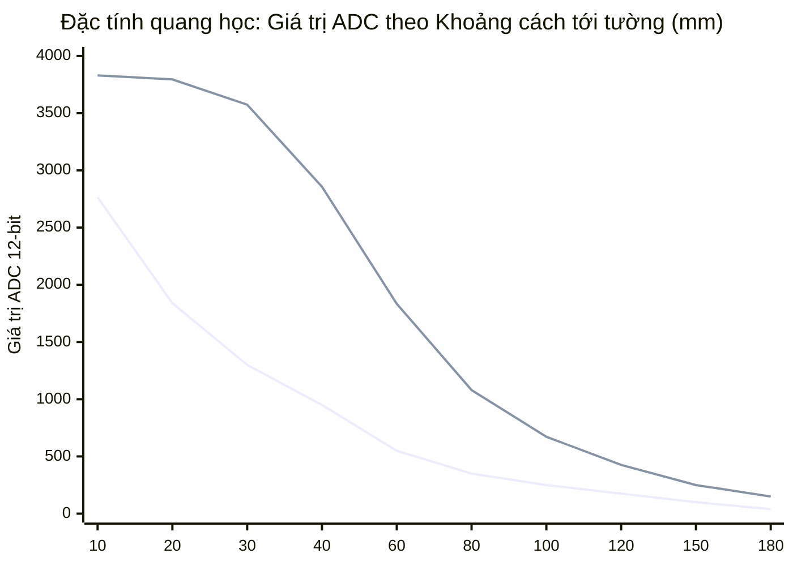

# TÍCH HỢP PHẦN CỨNG & THAM SỐ HIỆU CHUẨN (HARDWARE INTEGRATION)

Tài liệu này đặc tả chi tiết về thông số phần cứng, mô hình động học, đặc tính vật lý của cảm biến/cơ cấu chấp hành và các hằng số hiệu chuẩn quan trọng trong hệ thống Robot Micromouse STM32F411CEU6.

---

## 1. Mô hình Động học & Kích thước Cơ khí Robot

Robot sử dụng cơ cấu truyền động **hai bánh vi sai độc lập (Differential Drive Robot)** với 2 bánh chủ động phía sau và các điểm tựa trượt hoặc bánh dẫn hướng phụ:

```text
                     Mũi xe (Nose)
                 +-------------------+
                 |    [FL]   [FR]    |  <-- 2 Mắt IR trước (nhìn thẳng)
                 |                   |
                 | [L]           [R] |  <-- 2 Mắt IR bên (nhìn xiên ~45°)
                 |                   |
        70.0 mm  |                   |
                 |                   |
                 |                   |
    Trục bánh -> |===O===========O===|  <-- Tâm 2 bánh xe chủ động (Bề rộng W = 76.0 mm)
        30.0 mm  |   Bánh Trái   Bánh Phải  |
                 +-------------------+
                     Đuôi xe (Tail)
                 |<----- 80.0 mm ---->|
```

### Các thông số hình học đo đạc thực tế:
- **Chiều dài tổng thể:** $100.0\text{ mm}$.
- **Chiều rộng thân xe:** $80.0\text{ mm}$.
- **Vị trí trục bánh xe:** Cách đuôi xe $30.0\text{ mm}$, cách mũi xe $70.0\text{ mm}$.
- **Bề rộng cơ sở bánh xe ($W = \text{TRACK\_WIDTH\_MM}$):** $76.0\text{ mm}$ (Mép trong 2 bánh cách nhau 72 mm, mép ngoài cách nhau 80 mm, bề rộng lốp cao su 4 mm; tâm hai bánh cách nhau $(72 + 80) / 2 = 76.0\text{ mm}$).
- **Bán kính quét khi quay tại chỗ (Sweep Radius):**
  $$R_{\text{sweep}} = \sqrt{70.0^2 + \left(\frac{80.0}{2}\right)^2} = \sqrt{4900 + 1600} \approx 80.62\text{ mm}$$
  Trong mê cung tiêu chuẩn có kích thước ô $180\text{ mm}$ và độ dày vách tường $12\text{ mm}$, nửa khoảng lọt lòng hành lang là $(180 - 12) / 2 = 84.0\text{ mm}$. Khi robot quay tại chỗ ở tâm ô, mũi xe quét qua hành lang với khoảng hở an toàn chỉ còn:
  $$\Delta = 84.0 - 80.62 \approx 3.38\text{ mm}$$
  > [!WARNING]
  > Khoảng cách an toàn chỉ ~3.4 mm. Do đó, việc định tâm robot chính xác tại tâm ô trước khi thực hiện quay 90° hoặc quay đầu 180° là bắt buộc để tránh va quẹt góc mũi xe vào vách tường.

---

## 2. Hệ thống Truyền động & Encoder Đo Quãng đường

### 2.1 Bánh xe & Encoder
- **Độ phân giải Encoder:** $700\text{ xung / vòng bánh}$ (`ENCODER_CPR = 700.0f`).
- **Đường kính bánh xe danh định:** $30.0\text{ mm}$.
- **Đường kính bánh xe HIỆU DỤNG khi chịu tải:**
  Lốp cao su mềm bị nén lún dưới trọng lượng của pin và robot, khiến bán kính lăn thực tế nhỏ hơn bán kính hình học. Số liệu đo đạc thực tế qua bài test chạy thẳng 1 m:
  - Bánh trái: $D_L = \text{WHEEL\_DIAMETER\_L} = 29.24\text{ mm}$.
  - Bánh phải: $D_R = \text{WHEEL\_DIAMETER\_R} = 29.03\text{ mm}$.
  - Hệ số quy đổi xung sang quãng đường:
    $$\text{MM\_PER\_COUNT\_L} = \frac{\pi \times 29.24}{700} \approx 0.13123\text{ mm / xung}$$
    $$\text{MM\_PER\_COUNT\_R} = \frac{\pi \times 29.03}{700} \approx 0.13029\text{ mm / xung}$$

### 2.2 Mạch Cầu H Điều khiển Động cơ (DRV8833)
- **Phương thức phát xung:** Timer PWM 20 kHz (`ARR = 2999`, `PSC = 0`).
- **Chế độ phát xung:** Đẩy / Phanh (Drive / Brake - Slow Decay):
  - Bánh trái: `IN1` nối `TIM1_CH2N` (PB0), `IN2` nối `TIM1_CH3N` (PB1).
  - Bánh phải: `IN1` nối `TIM5_CH4` (PA3), `IN2` nối `TIM5_CH3` (PA2).
- **Đặc tính ma sát tĩnh (Stiction Dead-zone):**
  - Để thắng ma sát tĩnh từ trạng thái dừng, bánh xe cần tối thiểu một lượng xung PWM $\approx 450 - 500$ đơn vị.
  - Khi đã chuyển động ở dải tốc độ $150 - 300\text{ mm/s}$, quan hệ giữa Duty PWM và vận tốc là tuyến tính:
    - Bánh trái: $\text{Duty} \approx 832 \text{ @ } 155\text{ mm/s}$, $1058 \text{ @ } 200\text{ mm/s}$, $1523 \text{ @ } 297\text{ mm/s}$.
    - Bánh phải: $\text{Duty} \approx 852 \text{ @ } 155\text{ mm/s}$, $1070 \text{ @ } 200\text{ mm/s}$, $1555 \text{ @ } 297\text{ mm/s}$.
  - Do đó các tham số Feedforward được xác lập:
    $$K_s = 80 - 85, \quad K_f = 4.85 - 4.95, \quad K_a = 0.17$$

---

## 3. Đặc tính Cảm biến Hồng ngoại (IR Optical Wall Sensors)

Robot sử dụng 4 cặp LED phát hồng ngoại và quang transistor (Phototransistor) thu ánh sáng phản xạ từ vách tường:
- **Kênh FL (Trước - Trái):** Chân PA4 (ADC1_IN4).
- **Kênh L (Bên Trái):** Chân PA5 (ADC1_IN5) - Nhìn xiên góc ~45°.
- **Kênh R (Bên Phải):** Chân PA6 (ADC1_IN6) - Nhìn xiên góc ~45°.
- **Kênh FR (Trước - Phải):** Chân PA7 (ADC1_IN7).



### Hiện tượng Phi đối xứng & Bão hòa:
1. **Độ nhạy lệch pha:** Kênh FL nhạy hơn kênh FR từ 2.4 đến 2.8 lần ở cự ly xa.
2. **Hiện tượng Bão hòa:** Kênh FL bắt đầu nén phi tuyến từ giá trị thô $3775$ và bão hòa hoàn toàn ở mức $3830$ (khi kênh FR chỉ mới đạt $\approx 1850$).
3. **Bảng quy đổi nội suy tuyến tính (`IR_FL_ToRef`):**
   - Ánh xạ 21 điểm thực nghiệm đưa kênh FL về cùng thang đo với FR:
     `ir_fl_raw[21]` $\to$ `ir_fl_ref[21]`.
   - Ngưỡng cắt bão hòa: `IR_FL_SAT = 3800`.
   - Sau khi quy đổi, sai số trung vị giữa hai mắt trước chỉ còn $1.4\%$.
4. **Mốc giá trị khi xe ở tâm ô (Cell Center Baseline):**
   - Mắt trái thô: $\text{IRL} = 240$ (`WALL_CENTER_L_IR`).
   - Mắt phải: $\text{IRR} = 280$ (`WALL_CENTER_R_IR`).
   - Ngưỡng xác nhận có vách bên: $\ge 170$ (`WALL_SIDE_PRESENT_IR`). Dưới 170 coi như không có vách bên (khoảng hở mở).
   - Ngưỡng vách trước ở cự ly tâm ô (~24 mm): $\text{TB(FL, FR)} > 400$ (`MAZE_FRONT_NEAR_IR`).
   - Ngưỡng vách trước ở cự ly biên ô (~114 mm): $\text{TB(FL, FR)} > 120$ (`MAZE_FRONT_FAR_IR`).

---

## 4. Cảm biến Quán tính IMU MPU6500

Cảm biến MPU6500 (hoặc lõi tương thích MPU9250 mã `WHO_AM_I = 0x71`) được gắn trực tiếp trên bo mạch trung tâm:
- **Giao tiếp:** I2C1 Fast Mode 300 kHz (SCL: PB6, SDA: PB7), đọc DMA tự động.
- **Tư thế lắp đặt phần cứng:**
  - Chip được lắp **úp mặt xuống (Inverted mounting)**.
  - Trọng trường tĩnh tại trạng thái nằm yên trên sàn:
    $$A_x \approx +0.16\text{ g}, \quad A_y \approx +0.15\text{ g}, \quad A_z \approx -1.17\text{ g}$$
  - Góc Roll tĩnh $\approx 173^\circ$. Trục $Z$ bị ngược chiều so với hệ quy ước chuẩn $\to$ Bắt buộc định nghĩa `YAW_SIGN = (-1)`.
- **Dải đo gia tốc (Accelerometer Full Scale):**
  - Cấu hình dải đo $\pm 8\text{ g}$ (`ACCEL_FS_CFG = 0x10`, độ nhạy $4096 \text{ LSB/g}$).
  - *Lý do không dùng $\pm 2\text{ g}$:* Do trục $Z$ nằm yên đã là $-1.17\text{ g}$, nếu dùng dải $\pm 2\text{ g}$ thì khoảng hở đo hướng âm chỉ còn $0.83\text{ g}$. Khi xe chạy qua mối ghép sàn hoặc gờ mấp mô, tín hiệu xóc vượt quá $-2.0\text{ g}$ sẽ bị cắt gọt (clipping) ngay trong phần cứng của chip trước bộ lọc DLPF, làm sai lệch tích phân vận tốc thẳng đứng $V_z$ và gây báo động nhấc xe giả. Dải $\pm 8\text{ g}$ cung cấp khoảng hở dư thừa tới $6.83\text{ g}$.
- **Bộ lọc số phần cứng (DLPF):**
  - Con quay Gyro: $41\text{ Hz}$ (`GYRO_DLPF_CFG = 3`, độ trễ $5.9\text{ ms}$). Giữ băng thông đủ rộng cho vòng điều khiển phản hồi góc quay.
  - Gia tốc kế Accel: $20\text{ Hz}$ (`ACCEL_DLPF_CFG = 4`). Triệt tiêu rung động cơ học từ động cơ và bánh xe.

---

## 5. Bảng Tổng hợp Tham số Hiệu chuẩn Hệ thống (`pid.h`, `mpu6500.h`, `adc.h`, `solving_maze.h`)

| Nhóm tham số | Tên Macro Define | Giá trị | Ý nghĩa kỹ thuật & Hướng dẫn căn chỉnh |
| :--- | :--- | :---: | :--- |
| **Bánh xe & Động học** | `WHEEL_DIAMETER_L` | `29.24f` | Đường kính bánh trái hiệu dụng (mm). Tăng nếu xe chạy thực tế thừa quãng đường |
| | `WHEEL_DIAMETER_R` | `29.03f` | Đường kính bánh phải hiệu dụng (mm) |
| | `ENCODER_CPR` | `700.0f` | Số xung của đĩa encoder trên một vòng quay bánh xe |
| | `TRACK_WIDTH_MM` | `76.0f` | Bề rộng cơ sở tâm hai bánh xe (mm) |
| | `YAW_SCALE` | `1.0f` | Hệ số khuếch đại góc con quay. Hiệu chuẩn qua `Gyro_Spin_Calibrate()` |
| **PID Vận tốc bánh** | `MAX_ACCEL_MMS2` | `2000.0f` | Gia tốc trượt lớn nhất khi đổi setpoint tốc độ (mm/s²) |
| | `PID_Kp` | `5.0f` | Hệ số tỉ lệ vòng PID vận tốc |
| | `PID_Ki` | `150.0f` | Hệ số tích phân vòng PID vận tốc (Ki/Kp = 30 ≈ 1/tau động cơ) |
| | `Ks` (Left / Right) | `80 / 85` | Feedforward bù ma sát tĩnh (PWM). Giúp bánh quay ngay khi có lệnh |
| | `Kf` (Left / Right) | `4.85 / 4.95`| Feedforward bù vận tốc (PWM trên mỗi mm/s) |
| | `Ka` (Left / Right) | `0.17 / 0.17`| Feedforward bù quán tính gia tốc (PWM trên mỗi mm/s²) |
| **Điều khiển Chuyển động**| `HEADING_KP` | `20.0f` | Hệ số kéo về hướng đích của PD giữ hướng (độ/s trên mỗi độ lệch) |
| | `HEADING_KD` | `0.5f` | Hệ số hãm tốc độ quay của PD giữ hướng |
| | `HEADING_MAX_DPS` | `90.0f` | Vận tốc góc tối đa cho phép khâu sửa hướng tác động khi đi thẳng (°/s) |
| | `MOVE_DECEL_MMS2` | `1000.0f` | Gia tốc hãm dùng tính điểm giảm tốc profile căn bậc 2 (mm/s²) |
| | `STRAIGHT_PWM_HEADROOM`| `200` | Khoảng dự trữ PWM không bị bão hòa dành riêng cho khâu bẻ lái |
| **Căn giữa ô & Tránh vách**| `WALL_CENTER_KP` | `60.0f` | Độ nhạy lái bù khi lệch tâm ô theo cảm biến IR |
| | `WALL_CENTER_MAX_DEG` | `5.0f` | Góc bẻ lái bù tối đa khi cân giữa ô (độ) |
| | `WALL_CENTER_L_IR` | `240.0f` | Mốc tín hiệu IRL thô khi robot đứng đúng tâm ô |
| | `WALL_CENTER_R_IR` | `280.0f` | Mốc tín hiệu IRR khi robot đứng đúng tâm ô |
| | `WALL_SIDE_PRESENT_IR`| `170.0f` | Ngưỡng phân định có vách bên ($\ge 170$) hay vách trống ($< 170$) |
| **Căn vuông góc tường** | `WALL_TARGET_IR` | `1700.0f` | Điểm dừng mục tiêu trước vách tường phẳng |
| | `WALL_STOP_IR` | `2000.0f` | Ngưỡng quá gần tường: kích hoạt lùi xe |
| | `WALL_ALIGN_TOL_DEG` | `0.5f` | Độ sai lệch góc tối đa chấp nhận coi là đã vuông góc (độ) |
| | `WALL_ALIGN_MAX_MS` | `4000U` | Giới hạn thời gian tối đa cho 1 chu kỳ căn tường tránh treo máy (ms) |
| **Tốc độ Giải mê cung** | `MAZE_SEARCH_SPEED_MMS`| `400.0f` | Vận tốc khi chạy dò tìm đường khám phá (mm/s) |
| | `MAZE_RUN_SPEED_MMS` | `500.0f` | Vận tốc chạy bứt tốc Mode 2 theo đường tối ưu (mm/s) |
| | `MAZE_SENSE_BEFORE_MM`| `90.0f` | Cự ly đọc vách trước tâm ô (mm). Trục bánh tới biên ô thì đọc |
| **Bảo vệ & An toàn** | `LIFT_TILT_DEG` | `20.0f` | Ngưỡng góc nghiêng xác nhận robot bị nhấc bổng khỏi sàn (độ) |
| | `LIFT_VZ_MS` | `0.12f` | Ngưỡng vận tốc tịnh tiến đứng xác nhận bị nhấc (m/s) |
| | `LIFT_CONFIRM_S` | `0.2f` | Thời gian duy trì liên tục để chốt nhấc xe, tránh gờ sàn (200 ms) |
| | `CRASH_JERK_G` | `1.10f` | Ngưỡng độ giật gia tốc mặt phẳng ngang phát hiện đâm tường trực diện |
| | `PAUSE_STILL_MS` | `3000U` | Thời gian đứng yên liên tục để robot tự khôi phục chạy tiếp (3000 ms) |

---

## 6. Các Điểm Chú Ý Sống Còn khi Bảo Trì & Phát Triển (Hardware Gotchas)

1. **Không can thiệp cấu hình NVIC trong CubeMX:**
   Tất cả ngắt ngoại vi thời gian thực phải giữ mức ưu tiên 0, ngắt `SysTick` giữ mức ưu tiên 15. Tuyệt đối không gọi `HAL_Delay` trong bất kỳ ISR nào.
2. **Hiện tượng Bão hòa Cảm biến IR Kênh Trái:**
   Kênh FL bão hòa quang ở khoảng cách gần tường (~$14\text{ mm}$ tính từ mũi xe). Nếu thay đổi linh kiện phát/thu IR, bắt buộc phải đo đạc lại bảng nội suy 21 nút trong `adc.c`.
3. **Cơ cấu Cơ khí Bánh Trái (Tight Spot):**
   Nếu bánh xe bị kẹt cơ học một điểm trên mỗi vòng quay (tần số $\approx 2.7\text{ Hz}$ ở tốc độ $250\text{ mm/s}$), con quay Gyro sẽ xuất hiện các gai vận tốc góc chu kỳ. Cần khắc phục triệt để bằng gia công cơ khí (độ tròn vành, đồng trục khớp nối) thay vì tăng hệ số D của bộ PID.
4. **Cổng COM Bluetooth và Windows Semaphore Timeout:**
   Khi tắt nguồn robot, cổng COM ảo của Bluetooth trên Windows sẽ mất kết nối. Nếu phần mềm máy tính cố gắng ghi dữ liệu đồng bộ, Windows sẽ khóa luồng (hang) tới 20 giây (WinError 121). Ứng dụng `maze_viewer.py` bắt buộc phải duy trì luồng giao tiếp `SerialWorker` độc lập với giao diện Tkinter.
5. **Cổng nạp SWD và Vùng Flash Sector 7:**
   Luôn sử dụng tệp linker script `STM32F411CEUX_FLASH.ld` đã tùy biến ($384\text{ KB}$ FLASH). Không chọn tùy chọn "Erase Full Chip" trên phần mềm nạp mạch nếu muốn bảo tồn bản đồ mê cung đã lưu trong các lượt chạy trước.
