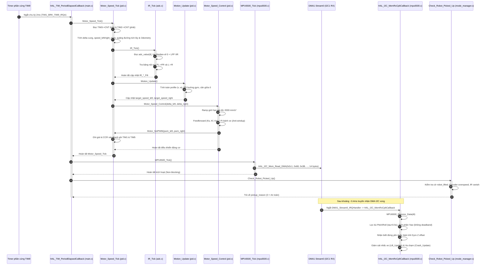
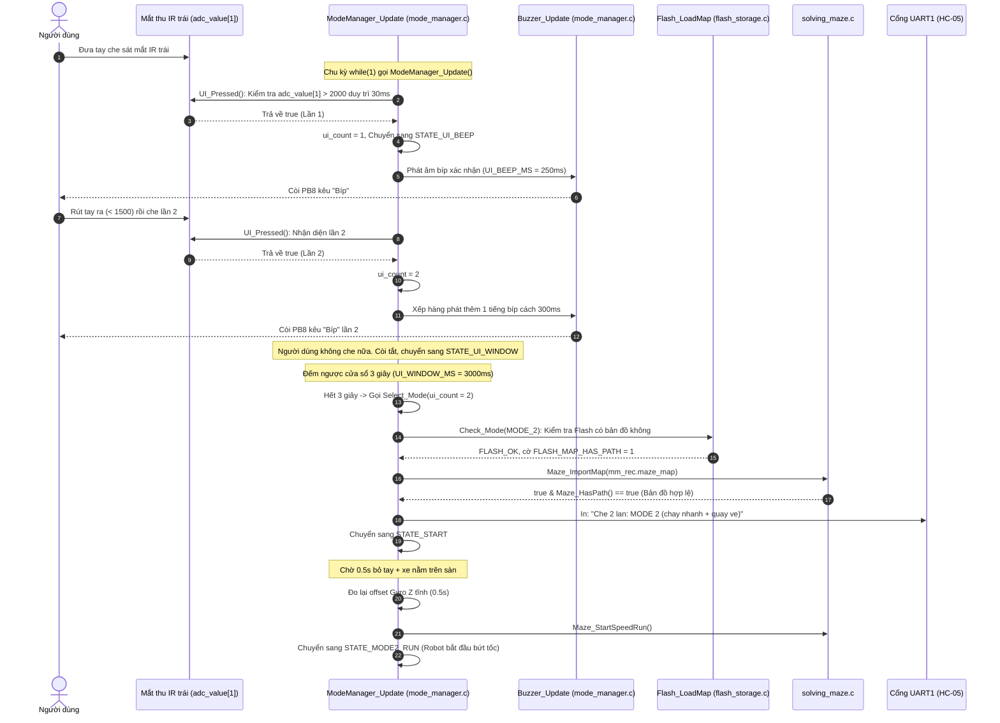
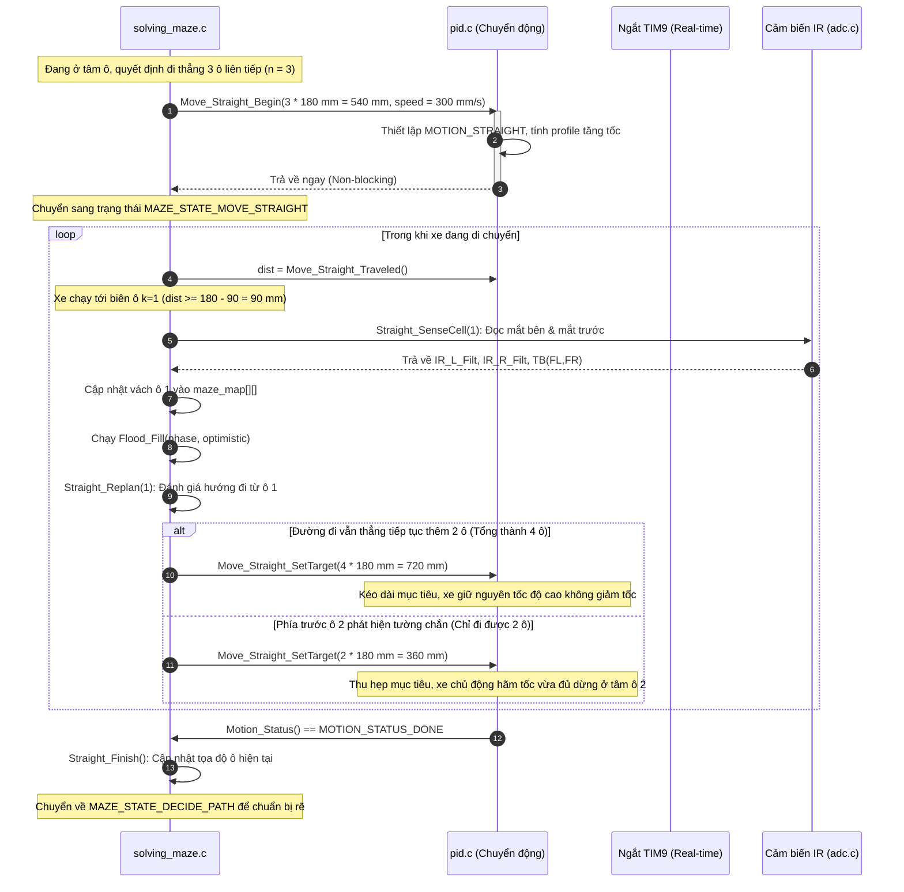
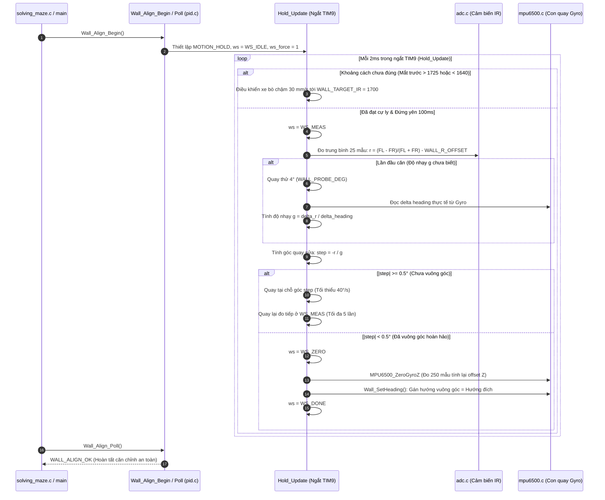
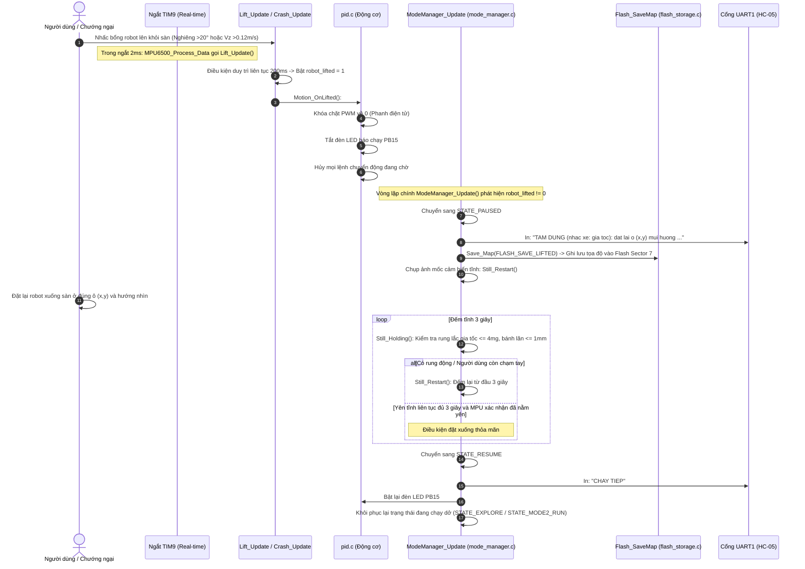
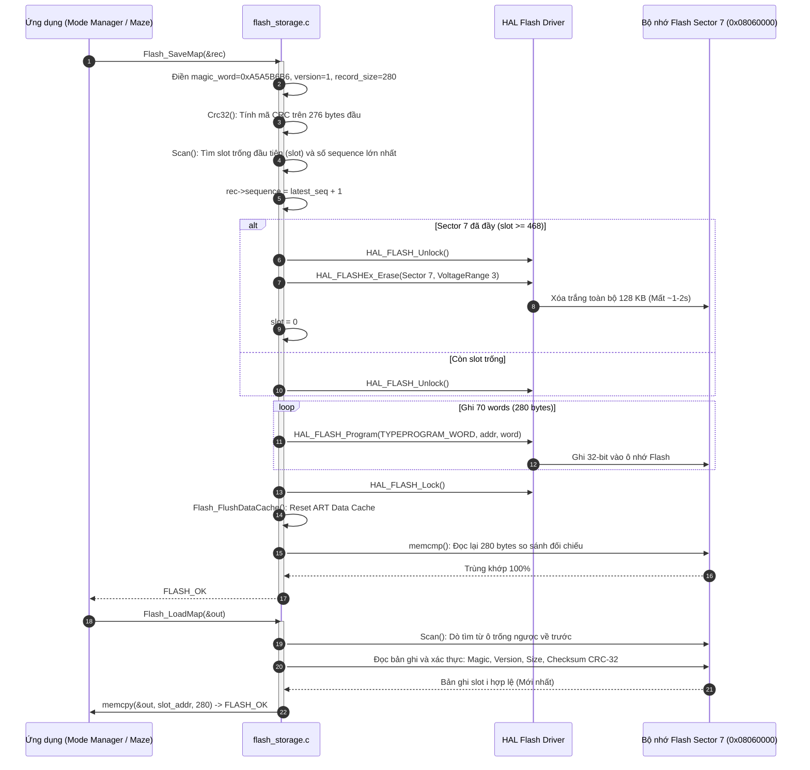
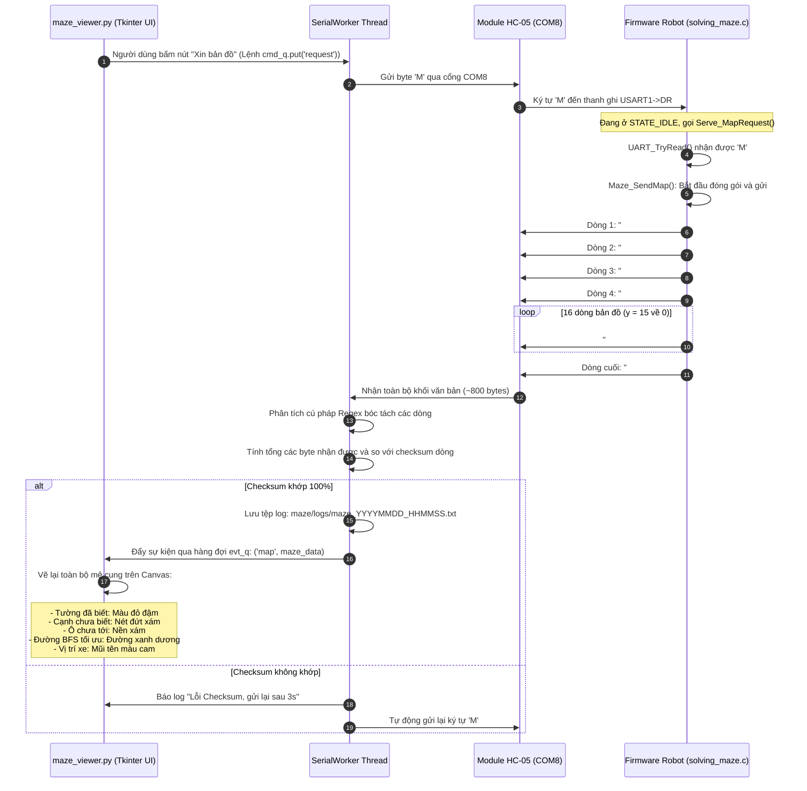

# SƠ ĐỒ TRÌNH TỰ TƯƠNG TÁC (SEQUENCE DIAGRAMS)

Tài liệu này cung cấp các sơ đồ tuần tự (Sequence Diagrams) trực quan hóa thứ tự tương tác theo thời gian giữa các thành phần phần cứng, hàm ngắt (ISR), các module phần mềm và máy tính bên ngoài trong các kịch bản vận hành trọng yếu.

---

## 1. Chu kỳ ngắt điều khiển thời gian thực 2 ms (TIM9 ISR)

Sơ đồ này mô tả chính xác những gì xảy ra mỗi 2 ms bên trong hàm ngắt `HAL_TIM_PeriodElapsedCallback` và callback I2C DMA.

---

## 2. Lựa chọn Chế độ qua IR trái & Còi Buzzer

Sơ đồ thể hiện chuỗi tương tác phi khóa (non-blocking) giữa người dùng, cảm biến quang học, máy trạng thái và bộ nhớ Flash.

---

## 3. Đi thẳng liên tục & Tính toán lại lộ trình khi đang chạy

Sơ đồ mô tả quy trình di chuyển gộp nhiều ô thẳng, đọc cảm biến trước tâm ô 90 mm và kéo dài hoặc rút ngắn quãng đường mà không dừng xe.

---

## 4. Tự căn Vuông góc Tường trước (`Wall_Align`)

Sơ đồ thể hiện chuỗi các bước vi chỉnh góc lái, đo đạc độ nhạy quang học và thiết lập lại mốc tọa độ quán tính con quay khi đối diện với tường phẳng.

---

## 5. Phát hiện Nhấc xe, Tạm dừng & Khôi phục Chuyển động

Sơ đồ mô tả quy trình phản ứng tức thời của firmware khi có sự cố cơ học (nhấc bổng robot hoặc va đập vào chướng ngại vật).

---

## 6. Lưu trữ và Nạp bản đồ từ Flash Sector 7

Sơ đồ mô tả cơ chế ghi tuần tự (Append-Log Wear Leveling) và đọc bản ghi mới nhất từ bộ nhớ Flash on-chip.

---

## 7. Đồng bộ Bản đồ Mê cung lên Máy tính qua Bluetooth HC-05

Sơ đồ mô tả giao thức truyền nhận văn bản ASCII có checksum 16-bit giữa vi điều khiển và phần mềm Python `maze_viewer.py`.

